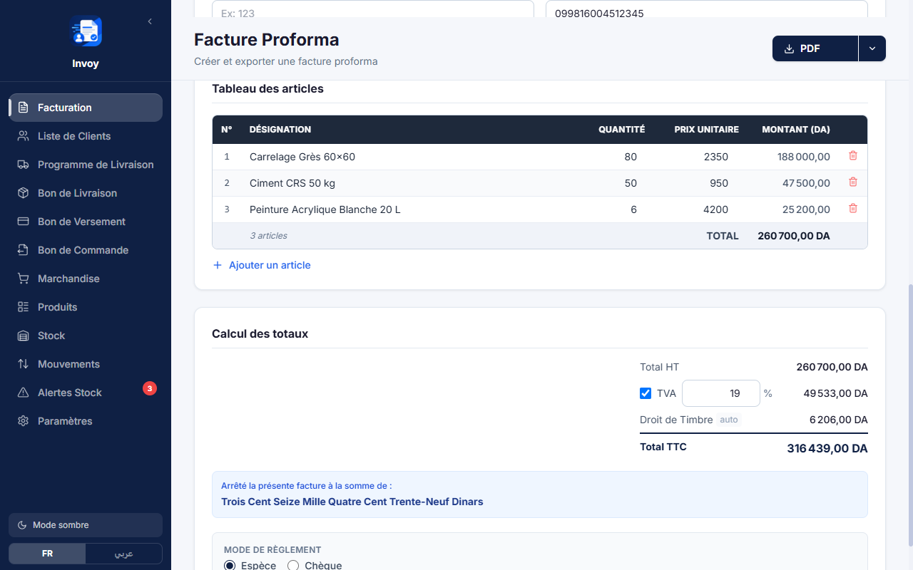
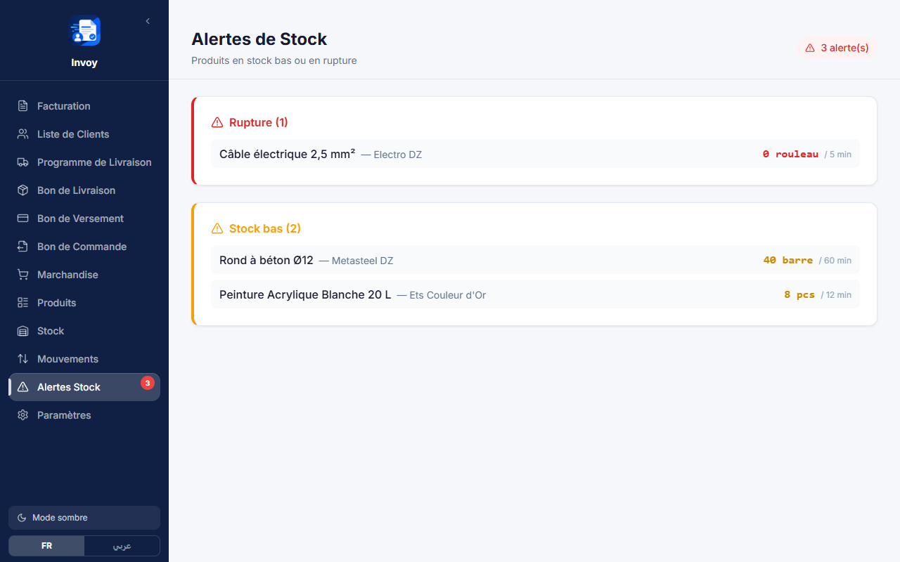
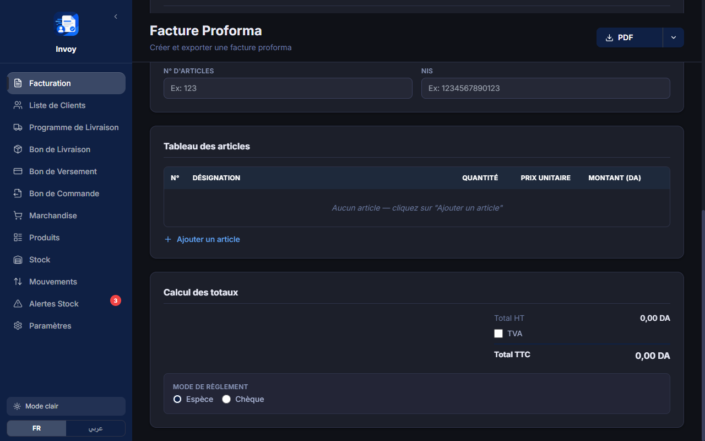
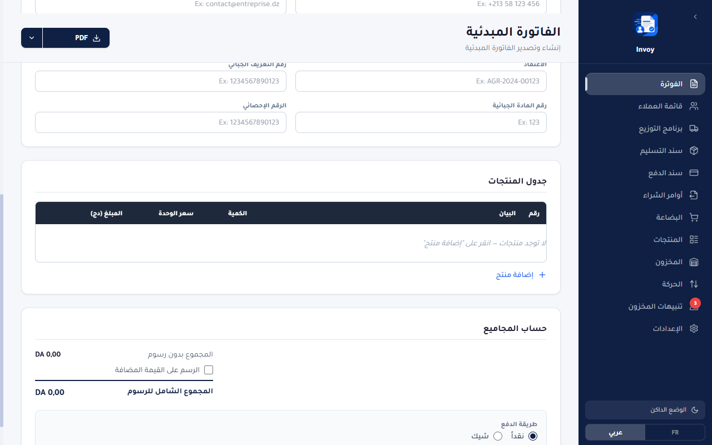
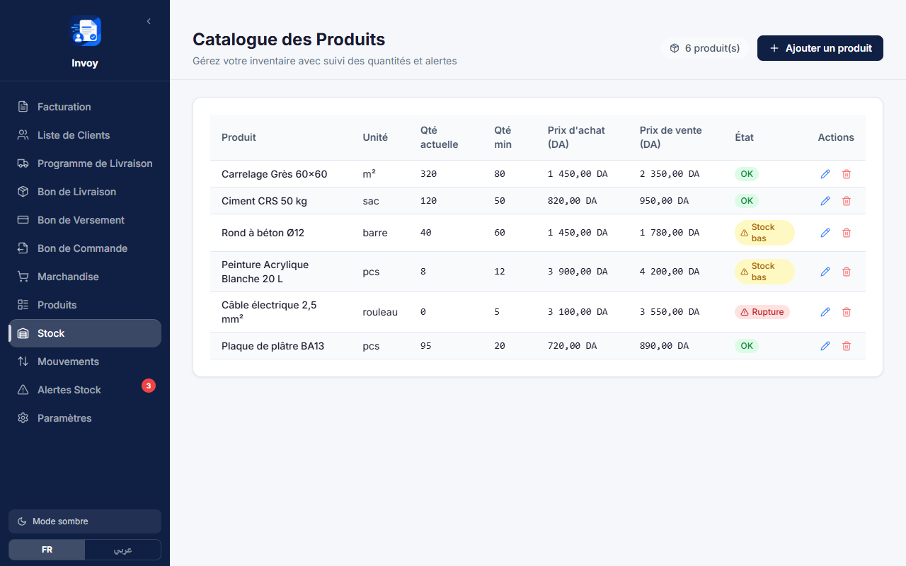
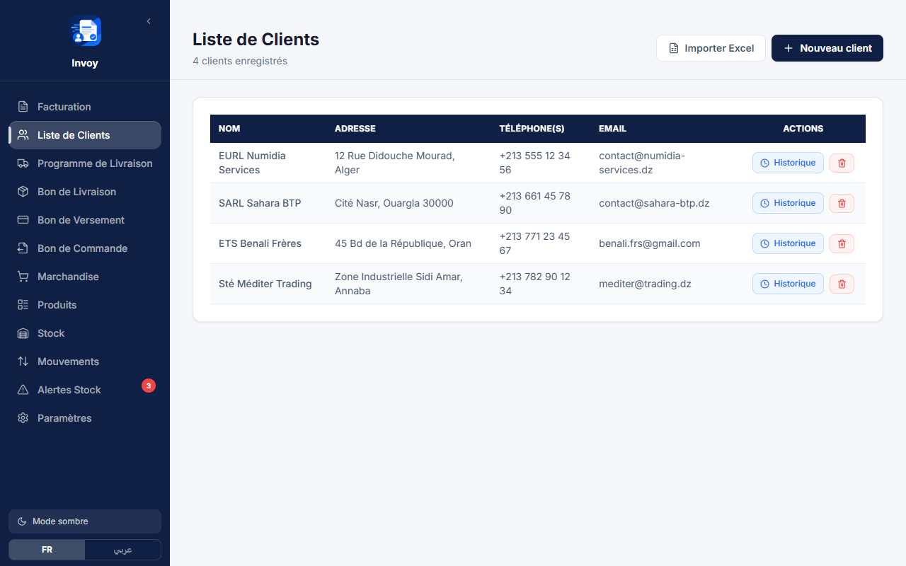

<div align="center">


# Invoy

**Facturation et gestion de stock hors ligne, conçues pour les entreprises algériennes.**

Factures proforma · Bons de livraison · Bons de versement · Bons de commande · Stock

[English](README.md) · **Français** · [العربية](README.ar.md)

[](src-tauri/tauri.conf.json)
[](LICENSE)
[](#-démarrer)
[](https://tauri.app)
[](https://react.dev)
[](#-démarrer)



*Facture en cours — lignes d'articles, totaux automatiques (HT / TVA / Droit de Timbre / TTC) et arrêté en toutes lettres.*

</div>

---

## Pourquoi Invoy

Beaucoup de petites entreprises en Algérie rédigent encore leurs factures sous Word. Invoy remplace ça par une application de bureau **100% hors ligne** : pas de compte, pas de serveur, pas de cloud — vos données restent sur votre machine. L'application parle le langage métier local dès l'installation : **montants en dinars (DA)**, **TVA 19%**, **Droit de Timbre**, coordonnées fiscales (**NIF**, **NIS**, **Agrément**, **N° d'articles**), interface **Français / Arabe (RTL)** et **export PDF silencieux** en un clic — sans boîte de dialogue d'impression.

## ✨ Fonctionnalités

### 📄 Documents commerciaux
- **Factures proforma & factures** — numérotation automatique par type de document, TVA 19%, Droit de Timbre, arrêté en toutes lettres, A4 ou A5, polices et couleurs personnalisables
- **Bons de livraison** — décrémentent automatiquement le stock à l'export
- **Bons de versement** — espèce ou chèque
- **Programme de livraison** — organisez la tournée du jour avec plusieurs clients, horaires et articles par client
- **Bons de marchandise** — enregistrez vos achats et poussez-les dans le stock
- **Bons de commande** — brouillon → envoyé → réceptionné partiellement → réceptionné, la réception met le stock à jour



### 📦 Stock
- Catalogue de produits avec **quantités min / max**, prix d'achat et de vente, fournisseur, notes
- État en direct par produit — **OK / stock bas / rupture / surstock** — avec badge d'alerte dans la barre latérale
- **Registre complet des mouvements** (entrée / sortie / ajustement) avec motifs : achat, vente, retour, inventaire, endommagé
- Supprimer un document **restaure le stock** (dans la limite des quantités disponibles) — le registre reste cohérent

### 👥 Clients
- Profil fiscal complet (NIF, NIS, Agrément, N° d'articles) imprimé sur les documents
- **Import Excel** avec association de colonnes et aperçu des premières lignes
- **Historique de documents par client** — rechargez n'importe quelle facture, bon de livraison ou bon de versement en un clic

### 🖥️ Expérience
- Interface **Français + Arabe** avec support complet de la droite à gauche
- **Mode sombre**
- **Export PDF silencieux** via WebView2 `PrintToPdf` — pas de dialogue, direct vers le fichier
- **Export DOCX** avec une mise en page identique au PDF
- **Sauvegarde / restauration JSON** pour transférer toutes vos données d'une machine à l'autre
- Raccourcis clavier, validation des saisies, format des nombres français (`1 450,00 DA`)

## 📸 Captures d'écran

| Facture — mode sombre | Interface arabe (RTL) |
|---|---|
|  |  |

| Catalogue du stock avec états | Liste des clients |
|---|---|
|  |  |

## 🧱 Stack technique

| Couche | Choix |
|---|---|
| Coque desktop | [Tauri 2](https://tauri.app) (backend Rust, hôte frontend WebView2) |
| Frontend | React 18 · Vite 5 · Tailwind CSS 3 · Radix UI · lucide-react |
| Documents | PDF via WebView2 `PrintToPdf` (Rust) · DOCX via `docx` · Import Excel via `xlsx` |
| Données | Store JSON local (`@tauri-apps/plugin-store`) — aucun serveur |
| Tests | Vitest — 61 tests unitaires (parsing monétaire, registre de stock, i18n, validation…) |

## 🚀 Démarrer

**Prérequis**
- Node.js 18+
- Toolchain Rust `stable-x86_64-pc-windows-msvc` (nécessite les Build Tools MSVC sur Windows)
- WebView2 Runtime (pré-installé sur Windows 10/11 avec Edge)

```powershell
# installer les dépendances
npm install

# lancer en mode dev (rechargement à chaud + fenêtre Tauri)
npm run tauri:dev

# lancer la suite de tests
npm test

# build de production (installateurs MSI + NSIS)
$env:CARGO_BUILD_JOBS = '1'   # évite le manque de mémoire sur les machines multi-cœurs
npm run tauri:build
```

Les installateurs sont générés dans `src-tauri\target\release\bundle\` (`msi\` et `nsis\`).

## 🗂️ Structure du projet

```
├─ src/                    # Application React (pages, composants, utils)
│  ├─ pages/               # Facture, Clients, Bon de Livraison, Stock, …
│  ├─ electron-docx/       # Générateur DOCX (mise en page identique au PDF)
│  ├─ utils/               # monnaie, i18n, validation, store de stock, gabarits PDF
│  └─ __tests__/           # Tests unitaires Vitest
├─ src-tauri/              # Backend Rust
│  └─ src/pdf.rs           # Export PDF silencieux via WebView2 PrintToPdf
├─ public/fonts/           # Inter (latin) + Tajawal (arabe)
└─ docs/screenshots/       # Captures d'écran utilisées dans les README
```

## 📝 Remarques

- **L'export PDF est réservé à Windows** (il repose sur WebView2) ; l'export DOCX fonctionne partout où l'application tourne
- Toutes les données (clients, documents, stock, paramètres) vivent dans un fichier de store local — utilisez **Paramètres → Sauvegarde** pour l'exporter/restaurer
- Le frontend tourne aussi dans un navigateur simple (`npx vite`) avec une version en mémoire de l'API — pratique pour retravailler l'interface rapidement

## 📄 Licence

Publié sous la [licence MIT](LICENSE) © 2026 ayoubghr-qwerty.

*Invoy était à l'origine une application Electron — elle a été portée vers Tauri 2 pour un binaire bien plus léger et une empreinte mémoire réduite, tout en gardant exactement la même interface et les mêmes mises en page de documents.*
